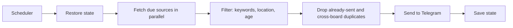

# jobscout

Polls free job APIs/feeds for DevOps roles and sends new matches to Telegram. Config lives in [config.toml](config.toml).

Sources: RemoteOK, We Work Remotely, Remotive, Jobicy, Himalayas, Arbeitnow, Adzuna (free key, India), and company boards on Greenhouse, Lever and Ashby.

## How one run works



State (`state.json`) holds sent job ids, last poll time per source and consecutive failures per source. A source that fails 6 runs in a row triggers a Telegram alert.

## Option A: GitHub Actions (recommended, no PC needed)

Runs in GitHub's cloud, so it works while your computer is off.

1. Use a personal GitHub account (not a work one) and create a **private** repo; push this folder.
2. Create a Telegram bot with `@BotFather`; send it a message; get your chat id from `@userinfobot`.
3. Repo > Settings > Secrets and variables > Actions: add `TELEGRAM_BOT_TOKEN`, `TELEGRAM_CHAT_ID` and optionally `ADZUNA_APP_ID`, `ADZUNA_APP_KEY` (free at https://developer.adzuna.com/signup).
4. Actions tab > `scrape` > Run workflow. After that it runs hourly ([workflow](.github/workflows/scrape.yml)); edit the `cron` line to change it.

The state is stored on an orphan branch named `state`. Free private-repo quota is 2000 Actions minutes/month; hourly runs use a small fraction. Public repos are unlimited but expose your `config.toml`.

## Option B: your Windows PC

Needs Python 3.11+ from python.org. In PowerShell inside this folder:

```powershell
powershell -ExecutionPolicy Bypass -File .\setup-windows.ps1   # creates .env on the first run
notepad .env                                                    # fill in the Telegram values
powershell -ExecutionPolicy Bypass -File .\setup-windows.ps1   # tests Telegram and schedules every 30 min
```

It runs only while the PC is on and you are logged in. Remove with `Unregister-ScheduledTask jobscout`.

Run only one option at a time: each keeps its own state, so both together would send every job twice.

Handy commands: `python -m jobscout --test` (Telegram check), `--dry-run` (preview, sends nothing), `--loop 30` (stay running).

Docker (any OS): `docker compose up -d --build`.

## Notes

- Keep personal tokens off a company laptop; do the setup from your own Windows PC or the GitHub web UI.
- The first run sends only the newest `first_run_limit` jobs and marks the rest as seen.
- LinkedIn, Indeed and Naukri are not included: they prohibit scraping and block it. Use their email alerts.
- Remotive, Himalayas and Jobicy ask for attribution and low request rates; the intervals in the config respect that. Their jobs must not be republished elsewhere. Personal alerts are fine.

Tests: `python -m unittest discover -s tests -t .`
